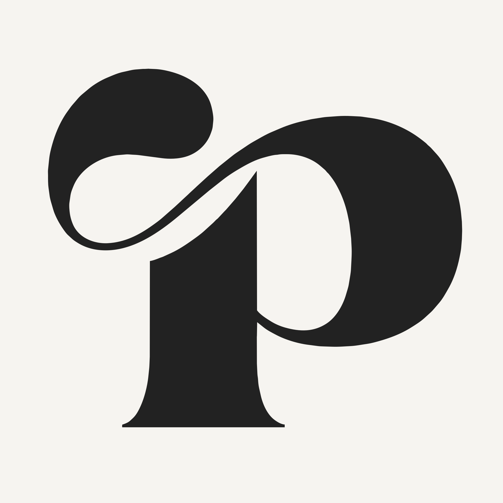

# PTheN's Portfolio

  

Welcome to my website's repository.

This portfolio is intended for personal and educational purposes only. This is a way for me to learn how to create and design websites using dedicated tools and workflows (for bigger future projects), while also having fun doing something I can maintain in a long term.

# Setup

This project requires / currently uses:

⭐ Astro - 7.4.13 (or higher)

🌼 DaisyUI - 5.8.2 (or higher)

🍃 Tailwind - 4.3.5 (or higher)

# Copyright Notice

This website and repository reserves all rights to its owner. Thus, it is source-available, but not open-source.

© 2026 PTheN Official
